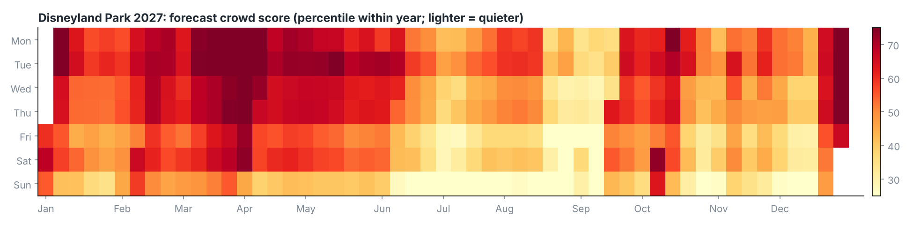
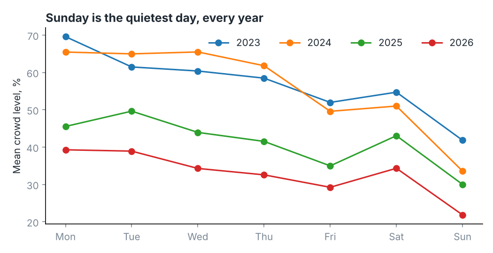

# Disneyland crowd forecaster

Day-level crowd history for Disneyland Park (1,379 days, Jan 2023 – Nov 10 2026, from queue-times.com's crowd calendar), a calendar
model, an honest backtest, and a forecast through December 2027.

## What the data says

- **Mid-week is not the quiet time. Sunday is, every year.** Average percentile by day: Mon 59, Tue 58, Wed 55, Thu 52, Fri 45,
  Sat 49, **Sun 34**. Weekend tickets cost more and cheaper Magic Keys are blocked out, and it shows.
- **Quietest stretch of the year: mid-August to mid-September** (−34 points), but Anaheim highs are ~86°F.
- **Best cool-weather windows for 2027** (3 consecutive days, lowest forecast score):

  | Dates (Fri–Sun) | Score | Avg high |
  |---|---|---|
  | Dec 10–12 | 27 | 69°F |
  | Dec 17–19 | 27 | 69°F |
  | Nov 5–7 | 33 | 75°F |
  | Dec 3–5 | 34 | 69°F |
  | Nov 19–21 | 37 | 75°F |
  | Jan 29–31 | 42 | 70°F |

  For what is left of 2026: Dec 11–13 (27), Dec 4–6 (34). If it has to be Tue–Thu, Dec 14–16 2027 (41) and Dec 7–9 (43) are the
  best cool-weather options; a typical Tue–Thu in March scores 65+.
- **Busiest:** Christmas–New Year (+25), Presidents' Day weekend (+25), Labor Day weekend (+21), Veterans Day week (+20), the week
  after New Year (+15), Thanksgiving week and the weeks around Easter (+9 to +12), Arizona/Utah fall break in mid-October (+11).
- **After-hours party days are much quieter for day guests**: 33% average crowd level vs 48% on other days (88 event days). The park
  closes early to day tickets, which matters little with small kids. 2027 party dates are not announced, so the forecast assumes none.

## How good is the forecast

Forward test: train on earlier years only, predict the next year.

| Test year | Rank correlation, daily | weekly | Actual crowd %, forecast-quietest fifth | all days | forecast-busiest fifth |
|---|---|---|---|---|---|
| 2025 | 0.42 | 0.46 | 25 | 41 | 53 |
| 2026 | 0.63 | 0.79 | 14 | 33 | 55 |

- The model clearly beats a month × weekday average at ranking days and at flagging busy ones (baseline correlations 0.30 and 0.43).
- At picking the very quietest days it is **no better than the baseline** (baseline 23 and 13). The cheap rule, Sundays and Fridays in
  low months, captures most of that benefit.
- The daily number is noisy: one day's value explains only about a quarter of the next day's. Scores are a percentile within the
  year, not a wait time, because the raw level drifted from 57 (2023) to 33 (2026).
- July 2023 is missing at the source. The source values were read off web pages month by month; `data/queue_times_calendar_raw.txt`
  holds them as captured, with day counts checked against the calendar.

## Files

- `src/crowd_model.py` — features, backtest, forecast, charts (`python src/crowd_model.py`)
- `src/collect_queue_times.py` — ride-level wait archiver for the free Queue-Times API. Running it on a schedule would replace the
  one-number-per-day source with real hourly waits. Written without network access and **not yet run against the live API**.
- `results/forecast_2026-11_to_2027-12.csv` — every day's score and flags; `results/best_3day_windows_any_days.csv`;
  `results/best_midweek_windows.csv`; `results/backtest.csv`; `results/calendar_effects.csv`

Crowd data: Powered by Queue-Times.com.
