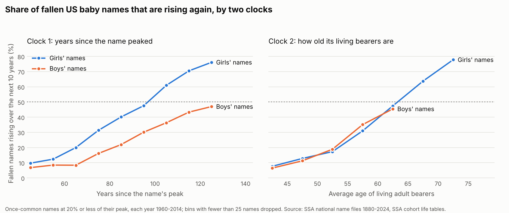

# When do old baby names come back? Testing the "100-year rule"

Baby-name writers say a name needs about a century to sound fresh again. This project tests that on every US name since 1880
(SSA national files, 1880–2024), asks what actually sets the clock, and checks whether any of it helps forecast which names
come back.

## Answer

**The rule is roughly right for girls, about 20 years early for boys, and it is counting the wrong thing.** A fallen name
starts rising when the people who still carry it have become old, not when a fixed number of years has passed. Once a name's
living adult bearers average about 63 years old, it has even odds of rising over the next decade, and that threshold is the
same for girls' and boys' names.

| Clock | Girls' names reach 50% odds of rising | Boys' names reach 50% | Girl-vs-boy odds ratio at the same clock reading |
|---|---|---|---|
| Years since the name's peak | 96 years (92–101) | 115 years (109–120)* | 2.15 (1.71–2.72) |
| Years since bearers' average birth year | 72 (70–75) | 77 (74–81) | 1.43 (1.11–1.78) |
| **Average age of living adult bearers** | **63.7 (62.5–65.1)** | **63.4 (61.9–65.5)** | **0.97 (0.74–1.22)** |

Ranges are 95% bootstrap intervals, resampling names. \*Boys' names reached 50% inside the observed range in 88% of resamples.

On the calendar clock, boys' names look slow: 80–90 years after peak, 40% of fallen girls' names are rising against 22% of
boys'. On the bearer-age clock the two lines sit on top of each other. The reason is that boys' names stay in use longer after
they peak, so their bearers are younger at any given distance from the peak: 90–100 years out, the living adult bearers of a
fallen girls' name average 63, and of a boys' name 54.

Three other things the data says:

- **There is no bump at 100.** The share of fallen names rising keeps climbing past it: 61% of girls' names at 100–110 years
  and 76% at 120–130. A century is where girls' names cross the halfway mark, not where a cycle peaks.
- **The first stirrings come much earlier.** One in five fallen girls' names is already rising 60–70 years after its peak.
- **It has become somewhat easier over time.** At a bearer age of 60–65, the share of girls' names rising was 43% in 1980–94,
  47% in 1995–2004 and 54% in 2005–14.

## Does it forecast?

A walk-forward backtest predicts each name's change in share of births over the next 10 years from seven origins
(1984, 1989, …, 2014). Each model is trained only on outcomes fully observed by its origin year.

Rank correlation between forecast and outcome, pooled over the seven origins:

| Model | All names with 100+ births (n = 20,834) | Fallen vintage names (4,401) | Fallen vintage names still falling (3,492) |
|---|---|---|---|
| Straight-line momentum | 0.473 | 0.577 | 0.416 |
| A. Momentum, gradient boosting | 0.576 | 0.646 | 0.522 |
| B. A + the name's own long history (peak, depth of fall, years since peak) | 0.595 | 0.663 | 0.547 |
| **B + bearer-age clock** | **0.601** | **0.676** | **0.569** |
| B + all ten living-bearer features | 0.566 | 0.670 | 0.563 |
| B + sound-neighbour trends | 0.607 | 0.651 | 0.527 |

- **Momentum does most of the work.** A name already moving keeps moving; that alone gets most of the skill.
- **The bearer-age clock adds a small, consistent gain** over model B in all three groups (+0.006, +0.014, +0.022; none of the
  bootstrap intervals includes zero). The gain is largest where it matters most: names that have not started moving yet.
- **In that hardest group the forecast is useful.** Only 23% of still-falling vintage names rose over the following decade.
  Of the model's top tenth of picks, 63% did (between 40% and 74% in each of the seven origins).
- **Throwing in every bearer feature backfires** on the broad universe (−0.029). Features such as "share of all bearers still
  alive" drift over time and the trees extrapolate badly.
- **Sound-neighbour trends are a wash.** Following Berger et al. (2012), I added the 5- and 10-year trend of other names
  sharing a name's final rhyme, last two letters and first letter. They help a little on all names (+0.012) and hurt on
  vintage names (−0.011 and −0.020). At a 10-year horizon I would not rely on them.

## Forecast for 2034 (a forward test)

`results/forecast_2024_to_2034.csv` holds the forecast for all 10,214 names, made on 2026-11-15 with data through 2024 using
the "B + bearer-age clock" model. The target is the change in share of births from the 2022–24 average to the 2032–34 average.
SSA publishes each year's names the following May, so this can be graded in May 2035.

Fallen vintage names that are **still flat or falling** but that the model expects to rise most (forecast multiple on share):

| Girls | | Boys | |
|---|---|---|---|
| Marjorie | ×1.6 | Don | ×1.4 |
| Mamie | ×1.6 | Ernest | ×1.4 |
| Bettie | ×1.5 | Lester | ×1.3 |
| Marion | ×1.5 | Fred | ×1.3 |
| Marie | ×1.5 | Sam | ×1.3 |
| Alberta | ×1.4 | Nick | ×1.3 |
| Mayme | ×1.4 | Hubert | ×1.2 |
| Sallie | ×1.4 | Lloyd | ×1.2 |

Names with fewer than 5 births in 2024 are left out of this table (they are in the CSV).

Vintage names already climbing that it expects to climb furthest: Florence (×4.0), Goldie, Maude, Maxine, Tillie, Mabel
for girls; Percy (×3.1), Booker, Chester, Cecil, Wilbur, Homer for boys. Expected to keep falling by about half: Karen, Erin,
Crystal, Kathryn, Derrick, Eric, Shawn, Jason.

## What was checked

- **The sex-gap result under 18 sample definitions** (peak share threshold × how far the name has fallen × "rising" or
  "doubling" as the outcome). On the years-since-peak clock girls' odds are 1.5 to 4.9 times boys' in every one. On the
  bearer-age clock the ratio runs from 0.81 to 1.28. `results/sex_gap_robustness.csv`
- **Two halves of the period.** Calendar clock: 1.64 (1960–89) and 2.50 (1990–2014). Bearer-age clock: 0.94 and 1.04.
- **Living-bearer estimates look sane.** For 2014 the method puts the average living Mildred at 74 with 28% of all Mildreds
  alive, and the average living Linda at 59 with 86% alive.
- **No look-ahead in features.** Peaks, troughs and momentum at year T use only data up to T; training targets end by T.

## Weaknesses

- **Elapsed time and bearer age are 0.86 correlated**, so the data cannot separate them name by name. The case for bearer age
  rests on the girl/boy contrast and on the small out-of-sample gain. Bearer age may also be standing in for something related,
  such as how long a name's run of popularity lasted.
- **Few boys' names have old bearers.** Above a bearer age of 65 there are only 13 boys' names in the sample, so the
  "same threshold" claim is tested up to about 65, not beyond.
- **The clock-only model was chosen after seeing the all-features model fail.** Its gain is small and should be read as
  suggestive until the 2034 forecast is graded.
- **Living bearers are estimated, not counted.** Cohort life tables exist by decade for 1900–2010; earlier cohorts use the
  1900 table, later ones the 2010 table. People born before 1937 appear in SSA data only if they lived to apply for a card,
  so their survival is taken conditional on reaching 1937. Migration is ignored.
- **SSA data limits.** Names given to fewer than 5 babies in a year are suppressed, spellings are counted separately
  (Mabel and Mable), and pre-1937 counts under-represent the true births.
- **Overlapping test windows.** The seven origins are five years apart with 10-year outcomes, so they are not independent.
- **US only.** No replication on another country's data.

## Files

| Path | What |
|---|---|
| `src/fetch_data.py` | Downloads the SSA files into `data/raw/` (git-ignored) |
| `src/panel.py` | Name × year share matrix |
| `src/bearers.py` | Living-bearer stock from cohort life tables |
| `src/features.py` | Feature panel, one row per name and origin year |
| `src/clock.py` | Clock analysis, bootstrap, robustness grid, figure |
| `src/forecast.py` | Walk-forward backtest, ablations, 2034 forecast |
| `data/processed/ssa_cohort_lifetables.csv` | SSA cohort life tables (decades 1900–2010) |
| `results/` | All tables, the figure, backtest predictions and the 2034 forecast |

Reproduce: `pip install -r requirements.txt`, then from `src/` run `fetch_data.py`, `features.py`, `clock.py`, `forecast.py`
(about five minutes in total).

## Sources

- [SSA national baby name files](https://www.ssa.gov/oact/babynames/limits.html), via the mirror at [dxdc/babynames](https://github.com/dxdc/babynames)
- SSA cohort life tables (Actuarial Study 120, Table 7), via [hadley/babynames](https://github.com/hadley/babynames)
- [Nameberry on the Hundred Year Rule](https://nameberry.com/blog/1910-baby-names-testing-the-100-year-rule)
- [Berger, Bradlow, Braunstein & Zhang (2012), "From Karen to Katie"](https://www.psychologicalscience.org/journals/psychological-science/0956797612443371/)
- CMU Pronouncing Dictionary (`cmudict`), for name rhymes
