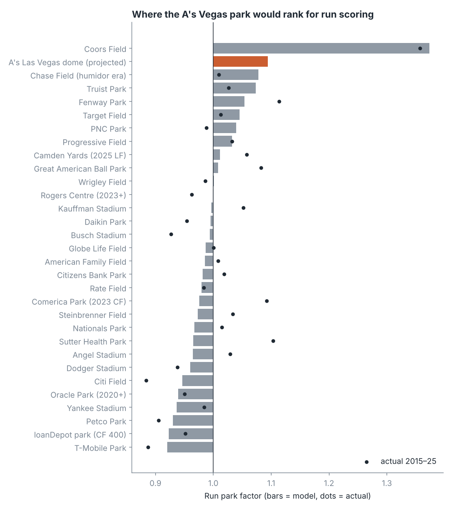

# How will the A's Las Vegas ballpark play?

A park-factor model built from 59,205 MLB games (Retrosheet game logs 2000–2025, event-file weather 2015–2025), used to project the
fixed-roof stadium opening on the Strip in 2028.

## Answer

| Scenario | Air density* | Runs | Home runs |
|---|---|---|---|
| **A's dome, rumored 340/380/415 fences** | 0.920 | **1.09** (80% range 1.02–1.20) | 0.98 (0.79–1.13) |
| A's dome, MLB-average fences | 0.920 | 1.11 | 1.09 |
| A's dome, cozy 325/365/400 | 0.920 | 1.11 | 1.27 |
| Same site, open-air at 95°F | 0.884 | 1.18 | 1.04 |
| Las Vegas Ballpark (Aviators, 3,012 ft, open-air) | 0.855 | 1.27 | 1.06 |
| Coors Field (actual 2016–25) | 0.817 | 1.36 | 1.16 |

\*1.00 = sea level at 70°F. Factors are home ÷ road rates, so 1.09 means 9% more runs than a neutral park.

- **It projects as the #2 run environment in MLB, behind Coors and well short of it**: about +9% runs, roughly 9.7 runs per game
  against an 8.9 league baseline.
- **The roof costs about 9 points of run factor.** At 2,133 ft the site would play ~1.18 outdoors in desert heat; holding it at ~73°F
  keeps the air denser.
- **The 2026 series at Las Vegas Ballpark is not a preview.** That park is ~900 ft higher and open to 95–100°F air; it models at 1.27.
- **Fences decide the home runs, not the runs.** Each foot of average fence distance moves HR about 1.5%. The rumored dimensions are
  8 ft deeper than the MLB average, which cancels the thin-air carry, the same trade Coors makes. Runs barely move across fence scenarios.
- **The offense arrives as contact, not power**: strikeouts −5%, BABIP +4%, doubles and triples +9%.
- **Closest real analog is Chase Field with its humidor**: 1.12 runs / 1.09 HR before the humidor (2010–17), 1.01 / 0.82 after
  (2018–25). Every MLB park stores balls in a humidor now, so Vegas starts in the "after" regime. Scaling Chase by the density gap
  gives ~1.06, the low end of this model's range.




## How much to trust it

- **Runs model: decent.** Leave-one-park-out R² 0.56, typical miss 5.8%. Fit with Coors removed, it predicts Coors at 1.44 (actual
  1.36), and the density coefficient barely changes (−2.1 without Coors, −1.9 with), so interpolating to Vegas is supported by the
  low-elevation parks alone.
- **Home-run model: weak.** Leave-one-park-out R² is ~0. The density effect on HR rests entirely on Coors, and a 5-point fence average
  misses short porches and wind. Treat the HR column as direction only.
- **Known misses:** Sutter Health Park 2025 (actual 1.10, predicted 0.97), old Globe Life Park (1.22 vs 1.03), Fenway (1.11 vs 1.00).
  Wind, foul territory, and odd walls are not modeled.
- Fence dimensions and wall heights in `data/park_traits.csv` were compiled by hand from memory of published figures and should be
  checked before reuse. The Vegas dimensions are unofficial; site elevation (2,133 ft) and Las Vegas Ballpark's (3,012 ft) are from
  press reports.

## Reproduce

```
git clone --depth 1 https://github.com/chadwickbureau/retrosheet /tmp/rs
python src/01_park_factors.py /tmp/rs     # -> data/park_season.csv, data/park_weather.csv
python src/02_model.py                    # -> results/
```

`02_model.py` also runs a drag-and-lift trajectory check: a 103 mph, 28° fly ball gains ~13 ft of carry at the Vegas dome's density.

Game data: Retrosheet (retrosheet.org), via the Chadwick Bureau GitHub mirror.
