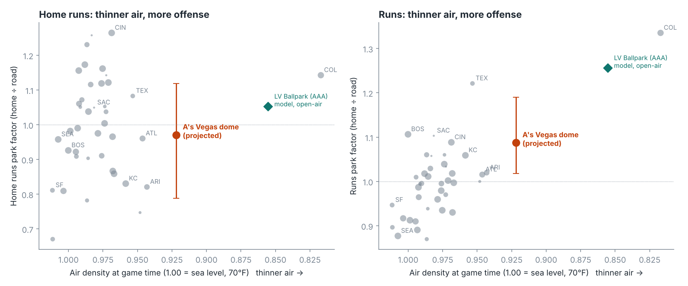

# How will the A's Las Vegas ballpark play?

A park-factor model from Retrosheet data (25,193 MLB games, 2015–2025, with game-time weather), projected onto the fixed-roof
stadium opening on the Strip in 2028, then attacked from several independent directions.

## Answer

**Runs: about +8 to +9% versus an average MLB park** (80% range +2% to +18%). **Home runs: decided by the fences**; roughly neutral
with the rumored deep dimensions, +10 to +35% with average ones.

| Scenario | Air density* | Runs | Home runs (range across methods) |
|---|---|---|---|
| **A's dome 72°F, rumored 340/380/415 fences** | 0.922 | **1.09** | 0.97–1.12 |
| A's dome 72°F, MLB-average fences | 0.922 | 1.10 | 1.08–1.36 |
| A's dome 72°F, cozy 325/365/400 | 0.922 | 1.09 | 1.24–1.71 |
| Same site, open-air at 95°F | 0.884 | 1.17 | 1.02–1.40 |
| Las Vegas Ballpark (Aviators, 3,012 ft, 95°F) | 0.855 | 1.24–1.26 | 1.05–1.62 |
| Coors Field (actual) | 0.817 | 1.32 | 1.12 |

\*1.00 = sea level at 70°F; the average MLB game is played at 0.975. Vegas sits about a third of the way from average to Coors.

## Six independent reads on the run number

| Method | Vegas dome runs |
|---|---|
| Main model: team-adjusted park effects ~ density + fence distance + wall height | 1.087 |
| Same, Coors removed | 1.111 |
| Same, Coors and Chase removed | 1.130 |
| Altitude and temperature as separate terms | 1.073 |
| Chase Field (humidor era, 1.03) moved to Vegas density | 1.068 |
| Straight interpolation between the average park and Coors | 1.091 |
| With a roof penalty term (roofed parks run 4% low, not statistically solid) | 1.049 |
| Day-to-day temperature slope inside open-air parks (upper bound, see below) | 1.160 |

Other variations (2018–25 only, 2021–25 only, no 2020, unweighted, no fence terms, raw home/road ratios, fence data jittered by
±4 ft) all land between 1.078 and 1.098. Full grid: `results/robustness_specifications.csv`.

## What was checked

**Inputs about the stadium (press and team sources)**
- Fixed roof, sealed, air-conditioned; the team's then-president said 70–72°F. Modeled at 72°F; 70°F gives 1.08, 75°F gives 1.10.
  Recorded temperatures under closed roofs elsewhere: Houston 73, Arlington 73, Tampa Bay 72, Miami 74.
- Site elevation 2,133 ft; Las Vegas Ballpark 3,012 ft. A field sunk 45 ft changes density by 0.2%.
- Dimensions are **not announced**. 340/380/415 is an unofficial report; one outlet expects a smaller field because the site is small.
- A humidor will be used, as in every MLB park since 2022 (70°F, 57% humidity). Dry indoor air is 0.4% denser than typical outdoor
  air at the same temperature: negligible.

**Data and method**
- Game-log parsing reproduces official league totals exactly (2019: 6,776 HR, 23,467 runs; 2021 and 2023 also exact).
- Park effects come from a game-level Poisson model with batting-team-season and pitching-team-season effects, so team quality and
  unbalanced schedules are removed. They correlate 0.99 with simple home/road ratios.
- Leave-one-park-out R² for runs is 0.53 (typical miss 5.8%). Fit without Coors, the model predicts Coors at 1.43 against 1.33.
- **Out-of-sample check, Las Vegas Ballpark:** model 1.24–1.26 for runs. Published PCL run factor for 2019 was 1.24, and the
  Aviators scored 36% more at home than on the road in 2025.

## What is weak

- **Home runs.** The cross-park density effect on HR depends entirely on Coors (coefficient −1.2 with it, +0.2 without). Inside
  open-air parks, hotter days produce many more homers (10°F ≈ +9%, matching published research), but that slope overpredicts Coors
  by a wide margin, so heat is doing more than thinning the air. A dome held at 72°F gets the altitude and none of the heat. The two
  methods bracket the answer; hence the ranges. Fence sensitivity is 1.5–2.5% of HR per foot of average distance.
- **Las Vegas Ballpark home runs** ran ~50% above the PCL norm; the cross-park method gives 1.05 and misses badly, the temperature
  method gives 1.62. Another sign that open-air desert heat, not altitude alone, drives the homers there.
- **Rank.** The projection is second to Coors among fitted values, but Fenway's actual run factor (1.10) is level with it and
  Sacramento's one season (1.11) is above it. "Top three" is the supportable claim.
- **Roof.** Roofed parks score about 4% less than the model expects (standard error 2.5%). If that is real, Vegas is nearer +5%.
- **Fence and wall inputs** are hand-compiled and cross-checked against one published chart; power-alley figures differ by source.
  The run projection moves about one point under ±4 ft of noise, so this matters for HR only.
- Individual park elevations were not re-verified against a single authoritative table.

## Corrections since the first version

- The 2024 season was missing: its game-log file is named in lower case and the loader skipped it. Restored (2,429 games).
- Indoor temperature changed from 73°F to 72°F to match the team's statement.
- Four park traits corrected (Truist wall heights, Rate Field alleys, old Globe Life right-center, Petco left field).
- Headline runs moved from 1.09 to 1.09; the HR range widened and the "#2 in MLB" claim was softened to "top three".

## Reproduce

```
git clone --depth 1 https://github.com/chadwickbureau/retrosheet /tmp/rs
python src/01_park_factors.py /tmp/rs   # park-season totals + weather
python src/02_model.py                  # first-pass model, charts
python src/03_game_table.py /tmp/rs     # game-level table with weather
python src/04_robustness.py             # team-adjusted effects, specification grid, temperature slope, anchors
```



Game data: Retrosheet (retrosheet.org), via the Chadwick Bureau GitHub mirror.
