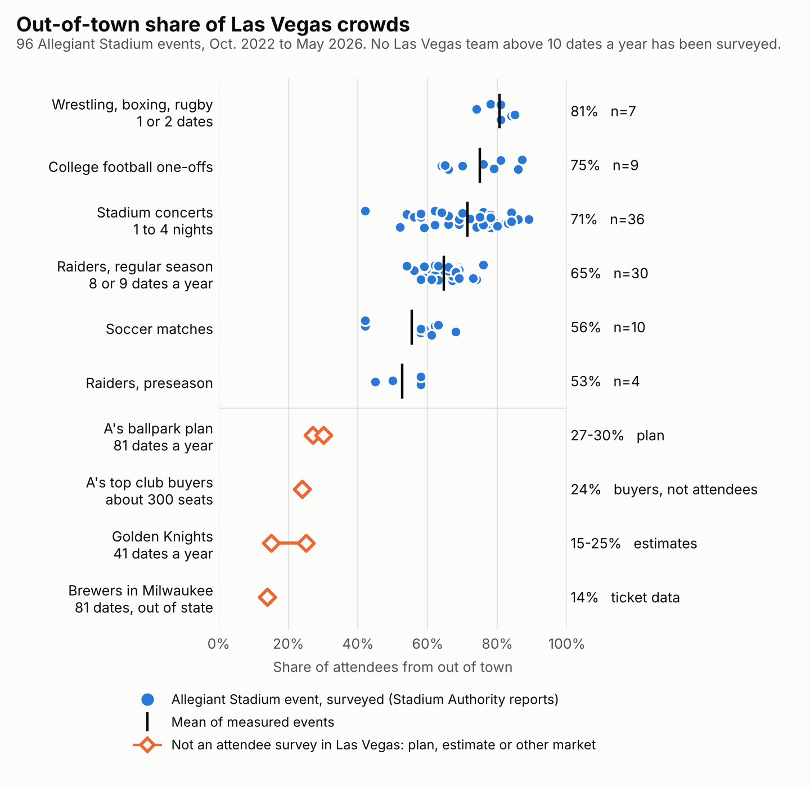

# Vegas visiting fans

Does the share of out-of-town fans in a Las Vegas crowd fall as a team plays more dates, and what does that mean for the A's
plan of 30% visitors across 81 home games?

Second version. Built from the Las Vegas Stadium Authority's own quarterly activity reports: 96 Allegiant Stadium events from
October 2022 to May 2026, each with scanned attendance, the surveyed out-of-town share and the share of those visitors who said
the event was their main reason for the trip. The first version used 39 events picked up from press coverage.

## Answer

**1. There is no date-count curve in Las Vegas data, and inside concerts it runs the other way.** Acts that play more nights
draw a higher visitor share: 66% for one-night concerts (18), 75% for two-night runs (14), 83% for the one four-night run.
Longer runs are booked for acts people travel to see. What sets the share is the kind of event, not how often it happens.

**2. The Raiders' local crowd is close to a constant.** Across 30 regular-season games in four seasons, locals in the building
average 19,720 with a standard deviation of 2,361. Opponent, weeknight, December and season do not move it. Visitors do all the
moving (27,500 to 45,100), and attendance tracks the visitor share (+0.64) and not the local count (-0.26).

**3. The A's visitor ask is about twice any measured benchmark for a team that plays every week.**

| | Dates | Visitors per date | Visitor tickets a year | Local tickets a year |
|---|---|---|---|---|
| Raiders 2025 (surveyed) | 10 | 34,400 | 344,000 | 209,000 |
| Golden Knights 2025-26 (estimated 15 to 25%) | 41 | 2,700 to 4,500 | 110,000 to 184,000 | 551,000 to 625,000 |
| Brewers 2025 (14% out of state, team ticket data) | 81 | 4,600 | 371,000 | 2,279,000 |
| A's plan (30%; legislative and traffic-study versions) | 81 | 7,900 to 8,800 | 643,000 to 714,000 | 1,501,000 to 1,667,000 |

- The plan is 1.9 to 2.1 times the Raiders' visitor tickets and 1.7 to 1.9 times the Brewers' out-of-state tickets.
- Two unrelated benchmarks for an every-week team land in the same place: about 4,500 visitors a game. The plan needs 7,900 to
  8,800.
- The plan's local side is 0.62 to 0.69 tickets per resident, at the low end of eight similar-sized one-team MLB metros (0.63
  to 1.68, median 0.79). The local count it needs per game (18,500 to 20,600) is what the Raiders draw.

**4. The plan's incremental-visitor assumption is cautious; its visitor count is not.** The plan counts 53% of visitors as
people who came to Las Vegas for the game. At Raiders games 86.5% say the game was their main reason, and across all 96 events
the figure is 90% and never below 72%. But at 4,500 visitors a game, even 53% yields 115,000 to 197,000 incremental visitors a
year from baseball, 34 to 58% of the 341,000 the plan implies for its 81 games (405,000 across all 95 planned events).

**5. In favor of the plan:** the first real sales data. The A's sold out their top club (about 300 seats) with 76% of buyers
from Southern Nevada, so 24% from elsewhere. Those are buyers of the most expensive seats, not attendees, but it is the only
number so far that is not a forecast, and it is near 30%. Baseball series also let one trip use two or three tickets: 643,000
to 714,000 visitor tickets is 214,000 to 357,000 trips, against the Raiders' 344,000. And the last forecast of this kind ran
low: 27% expected at Allegiant, 40 to 49% delivered in 2022.



## What was checked

**Share by kind of event** (`results/share_by_kind.csv`)

| Kind | Events | Out of town | Range | Came mainly for the event | Visitors per event | Locals per event |
|---|---|---|---|---|---|---|
| Wrestling, boxing, rugby | 7 | 80.6% | 74 to 85% | 96% | 40,800 | 9,400 |
| College football one-offs | 9 | 74.9% | 64 to 87% | 86% | 30,500 | 8,600 |
| Concerts | 36 | 71.5% | 42 to 89% | 94% | 34,800 | 13,500 |
| Raiders, regular season | 30 | 64.6% | 54 to 76% | 87% | 36,300 | 19,700 |
| Soccer | 10 | 55.5% | 42 to 68% | 83% | 20,500 | 15,500 |
| Raiders, preseason | 4 | 52.8% | 45 to 58% | 87% | 28,400 | 25,500 |

**Share against dates per year** (`results/curve_fit.json`, `results/curve_predictions.csv`,
`results/concert_share_by_run_length.csv`). Logit fit on log(dates), bootstrapped by run, annual event or Raiders season (54
clusters).

- All 96 events: slope -0.10, 80% interval -0.16 to 0.00. Stretched to 81 dates it gives 61%. That slope is the Raiders against
  everything else, nothing more.
- Concerts alone: slope +0.60, 80% interval +0.36 to +0.81.
- The four-night figure is one run (BTS, 2026), and every 2026 event in the data is a multi-night run in a strong quarter, so
  run length and year cannot be separated. One-night against two-night (18 and 14 events) is the solid part.

**Raiders game model** (`results/raiders_game_model.csv`, `raiders_by_season.csv`, `raiders_by_opponent.csv`). 34 games.

| Effect | Out-of-town share | Visitors | Locals |
|---|---|---|---|
| Preseason | -12.8 pts (t = -4.0) | -8,200 | +6,500 |
| Monday or Thursday night (5 games) | 0.0 pts | +1,300 | +900 |
| December or January | -2.2 pts (t = -0.9) | -2,800 | +100 |
| Division opponent | -0.2 pts | +700 | +600 |
| 2025 season against 2022 | -2.1 pts (t = -0.6) | -2,400 | +300 |

- Opponent is what matters: Vikings, Chiefs and Steelers games ran 70 to 74%, Giants, Chargers and Texans games 58 to 60%.
- 2025 had the lowest season share (62.8% against 65 to 66%) and the fewest visitors per game (34,800 against 36,200 to
  37,100), in the year Las Vegas visitation fell 7.5%. The difference is within noise for eight games.
- The share of visitors naming the game as their main reason slid each season: 89, 88, 86, 84%.

**Non-NFL events** (`results/non_nfl_model.csv`, `non_nfl_midweek.csv`). 62 events.

- Monday-to-Thursday events run 5.7 points lower (t = -1.6, 10 events), but midweek concerts draw the same visitor count as
  weekend ones (35,000 against 34,800). Two BTS nights on a Wednesday and Thursday drew 84% and 78%.
- June to August shows no difference.
- Soccer is the most local product in the building: 19 points below the baseline (t = -3.3).

**Other markets and the A's own numbers** (`data/benchmarks.csv`)

- Brewers: 14% of attendees from out of state, from team ticket data, and 41% of those stayed overnight. On 2025 attendance
  that is 371,000 out-of-state tickets and about 152,000 overnight. Milwaukee is 90 minutes from Chicago. Las Vegas has no
  comparable drive-in market closer than Southern California.
- A's legislative case: 2.6 million a year over 95 events, 30% from out of town, 53% of those incremental, 405,000 incremental
  visitors a year. A public comment in the Stadium Authority's August 2024 agenda book derives 26,476 a game and 4,210
  incremental visitors a game from that; the same arithmetic reproduces here.

## What is weak

- **Still no surveyed share for any Las Vegas team above 10 dates.** The Golden Knights range is three statements (25% in 2018,
  15 to 20% in 2021, a 10 to 15% target in 2017), none of them survey or ZIP data. T-Mobile Arena is privately owned and files no
  such report.
- **The Brewers figure is out of state, not out of metro,** and comes through a consultant study and legislative testimony, not
  a published table. In Milwaukee the gap between the two definitions is large (about half of fans are Wisconsinites from
  outside Milwaukee County). In Las Vegas it is small, which is why out of state is the nearer match to a Las Vegas visitor.
- **Peer tickets per resident flatter the peers** for the same reason: their totals include that drive-in hinterland.
- **"Main reason for travel" is asked of people who already said they were from out of town,** by the stadium operator. It is
  not the same thing as the plan's incremental visitor, though it is the closest measured quantity.
- **Out of town is residence, not rooting interest.** Applied Analysis describes Raiders crowds as about a third locals, a third
  Raiders fans from elsewhere and a third visiting-team fans.
- **Gaps in the reports.** Q1 2023 was not found on the authority's site and the Q1 2026 PDF did not extract as text, so the
  January 2023 and January 2026 Raiders games are missing. Reports before Q4 2022 carry no out-of-town column. UNLV games, high
  school events and open practices have no survey and are left out, as is the Super Bowl.
- **Raiders 2025 annual figures** scale nine surveyed games to ten dates.
- **Golden Knights attendance is announced,** and the team says earlier seasons' figures included broker-held tickets.
- The data was read from the PDFs through a text extraction step. NFL attendance by quarter was checked against the reports'
  own summary table for five quarters and matched exactly; the script asserts this on every run.

## Corrections

- **First idea (a four-row table read as a curve):** the Golden Knights estimate was carrying the conclusion.
- **First version of this folder (39 press-sourced events):** reported a December-and-January drop of 7.7 points (t = -2.0) in
  Raiders games. With all 34 games it is -2.2 points and not distinguishable from zero. Press coverage named the best-attended
  games, which made late-season games look worse than they are. That version also had two Coldplay nights swapped and the 2025
  Las Vegas Bowl attendance off by 100; both are fixed from the source.
- **Incremental visitors:** the first version used 16% of attendance (381,000 a year). The plan's own figures are 53% of
  visitors and 405,000 a year over 95 events.

## Data

| File | Contents | Source |
|---|---|---|
| `data/events.csv` | 96 events: date, kind, nights in the run, attendance, out-of-town share, main-reason share, report quarter | Las Vegas Stadium Authority, Stadium Activity Reporting (Section 7.4), Q4 2022 to Q2 2026, at lvstadiumauthority.com/meetings |
| `data/benchmarks.csv` | Golden Knights estimates, A's plan and club sales, Brewers, UFC, rodeo, the Allegiant forecast against 2022 | Press and public documents, cited per row |
| `data/mlb_markets_2025.csv` | 13 one-team MLB metros: 2025 attendance, July 2025 metro population | Baseball-Reference; Census |

## Reproduce

```bash
python3 src/01_visiting_fans.py
python3 src/02_chart.py
```

Requires `pandas`, `numpy`, `matplotlib`.

## What would make this better

- A Golden Knights, Aces or Aviators out-of-town share from ticketing ZIP codes. T-Mobile Arena has reported using purchase ZIP
  codes since 2018.
- The A's general season-ticket and deposit list by residence. The team says the list is over 20,000.
- Q1 2023, Q1 2026 and Q3 2026 activity reports, which add the two missing January games and the start of the 2026 season.
- The same Section 7.4 reporting for the ballpark from 2028. The authority's October 2024 minutes suggest matching reporting
  requirements for the ballpark, in which case the A's share would be measured from the first homestand.
